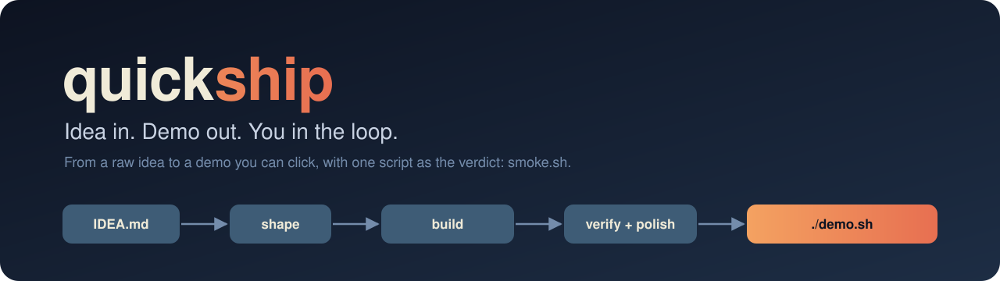

<p align="center">
  
</p>

<p align="center">
  <a href="https://github.com/Jimmycarroll2021/quickship/actions/workflows/tests.yml"></a>
  <a href="https://github.com/Jimmycarroll2021/quickship/releases"></a>
  <a href="LICENSE"></a>
  
  
</p>

## What it is

quickship takes a raw idea and gets it to a demo you can open, click through and feel, with nothing half-baked: no dead buttons, no placeholder text, no empty first screen. You drive it from a Claude Code session, one stage at a time, and you read the output of each stage before the next begins. The only thing that says PASS is `scripts/smoke.sh`, which boots the demo and walks its golden path. No agent declares the work done.

## Why v0.4 is smaller

v0.3 grew into a compliance harness: a BRIEF.yaml, a controller, ledgers, worktrees, an overseer, preflight checks and a gate.sh built on grep-based "done" criteria. In use it produced long runs, reports that claimed success the probes disproved, and no demo to click. v0.4 removes all of that and keeps one live check and four interactive stages. The heavy version remains available at [tag v0.3.1](https://github.com/Jimmycarroll2021/quickship/releases/tag/v0.3.1).

## Quickstart

```bash
git clone https://github.com/Jimmycarroll2021/quickship.git
bash quickship/scripts/init.sh ~/my-demo
cd ~/my-demo
./ship.sh "a tool that suggests tomorrow's prep quantities from a cafe's daily sales CSV"
```

`ship.sh` checks the tree is clean, writes `IDEA.md`, creates a `demo/<slug>` branch and starts Claude Code interactively. Then, inside the session:

1. `/shape` writes `DEMO_SPEC.md`. Read it. This is where you decide whether the idea has the right spine.
2. `/build` builds the golden path, `demo.sh` and the smoke spec.
3. `/verify` runs the gate and loops fixes, at most three rounds.
4. `/polish` removes anything that looks unfinished and writes `DEMO_READY.md`.
5. Leave the session and run `./demo.sh`.

Before opening a pull request, run `/code-review medium`. A human merges; agents never do. Ready-made ideas are in `examples/ideas/`.

## What each stage does

| Stage | Agent | Model | Writes | You decide |
|---|---|---|---|---|
| `/shape` | `shaper` | opus | `DEMO_SPEC.md` | whether the screens, seed data and cuts are right |
| `/build` | `builder` | sonnet | the app, `demo.sh`, `tests/smoke.spec.ts` or `tests/smoke.py` | whether to move on once the gate output looks sane |
| `/verify` | `verifier` (read-only) | sonnet | nothing | whether to accept the report after at most three fix rounds |
| `/polish` | `polisher` | sonnet | fixes, `DEMO_READY.md` | whether it feels right when you run `./demo.sh` |

Models are aliases, not pinned versions. `/simplify` runs after `/build` and after `/polish`.

## The gate: scripts/smoke.sh

`bash scripts/smoke.sh` runs five checks in order:

1. Secret scan of tracked and untracked files. Paths are printed, never values.
2. Stub scan, case-insensitive, for "coming soon", `href="#"`, "not implemented", "lorem ipsum", and `TODO`/`FIXME` in comments (a `"TODO"` status value is fine).
3. Boot `./demo.sh` on a free port, in its own process group.
4. Wait for the `health:` path from `DEMO_SPEC.md` to return 200. If the process dies, it fails early and prints the log tail.
5. Run `tests/smoke.spec.ts` (Playwright) or `tests/smoke.py` with `DEMO_URL` set. The spec must fail on console errors, page errors and 4xx or 5xx responses.

The last line of output is `PASS` or `FAIL`; exit status is 0 or 1. `PASS (spec skipped)` means there is no spec file at all. A spec whose runner is missing (Playwright not installed) is a FAIL, not a skip. Server output goes to `.claude/smoke.log`. The script never calls `claude`.

| Variable | Default | Effect |
|---|---|---|
| `SMOKE_BOOT_TIMEOUT` | 60 | seconds to wait for the health path |
| `SMOKE_STUB_EXCLUDE` | (none) | extra pathspecs the stub scan skips, on top of the built-in `tests`, `*.md`, `docs`, `.claude` and `scripts/smoke.sh` |
| `PORT` | a free port | port passed to `./demo.sh` |

## DEMO_SPEC.md

The shaper writes this exact shape, and `smoke.sh` reads the `health:` line:

```
# <name>

pitch: <one sentence: what the user can do and feel>
run: ./demo.sh
health: </path that returns 200 when ready>
stack: <one line>

## seed
- <5-10 realistic records, one per line>

## golden path
1. <action> -> <observable result>
2. ...

## out of scope
- <everything cut, one per line>
```

Every golden-path step names what must be visible afterwards, so the smoke spec can assert it.

## Guardrails

- **Deny list.** `.claude/settings.json` blocks `git push` (including the `git -C` and `--git-dir` forms) from Bash, `gh pr merge`, the GitHub MCP push and merge tools, `git reset --hard`, `rm -rf`, `pip install`, and reads or edits of `.env*` files (except `*.example`, `*.sample` and `*.template`) anywhere in the tree via the Read, Edit and Write tools. Commands run inside python, node or another interpreter are not inspected.
- **Sandbox.** Shell commands run in Claude Code's sandbox with a network allowlist of GitHub, npm, PyPI and the Playwright download hosts. Local port binding is allowed so `./demo.sh` can listen.
- **Stop hook.** When `DEMO_SPEC.md` and `demo.sh` both exist, `scripts/stop_hook.sh` runs `smoke.sh` as Claude tries to stop. On FAIL it blocks once and shows the last 15 lines. If Claude stops again (`stop_hook_active` is set) and `smoke.sh` still fails, it lets go with a message rather than looping; if it passes by then, it stays silent. The hook has a 900 s budget.
- **Web access.** Only the `shaper` has `WebSearch`. The verifier has no Write or Edit tools.

quickship is a development aid, not a security sandbox. Use it on projects and dependencies you trust.

## Requirements

- Git and bash 4+
- Claude Code 2.1.288 or later
- Python 3, used as the free-port and health-check fallback
- Node, only if the smoke spec is a Playwright one
- Windows works through Git Bash

## Project layout

| Path | Purpose |
|---|---|
| `CLAUDE.md` | the contract every agent reads |
| `ship.sh` | start a session on a fresh `demo/<slug>` branch |
| `scripts/smoke.sh` | the gate |
| `scripts/stop_hook.sh` | bounded Stop hook wrapper |
| `scripts/init.sh` | copy quickship into a target project, never overwriting |
| `.claude/settings.json` | deny list, sandbox, the one Stop hook |
| `.claude/agents/` | `shaper`, `builder`, `verifier`, `polisher` |
| `.claude/commands/` | `/shape`, `/build`, `/verify`, `/polish` |
| `examples/ideas/` | three short ideas to try |
| `tests/` | bash tests, no model calls; run with `bash tests/run.sh` |
| `.github/` | CI workflow and pull request template |
| `CHANGELOG.md`, `VERSION` | release history and current version |

## Contributing

The most useful report is a demo that lied. See [CONTRIBUTING.md](CONTRIBUTING.md).

## Licence

MIT. See [LICENSE](LICENSE).
